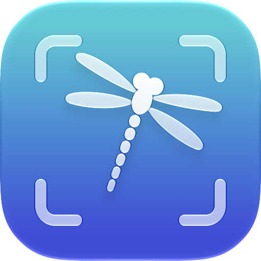

<p align="center">
  
</p>

<h1 align="center">Libellule</h1>

<p align="center">
  <strong>See everything. Share only what matters.</strong>
</p>

<p align="center">
  Screenshots, on-screen drawing and copy-text-from-anything for your Mac,<br>
  with automatic redaction that hides keys, card numbers and faces before you hit send.
</p>

<p align="center">
  
  
  
</p>

---

Libellule lives in your menu bar and turns a few keystrokes into a complete screenshot studio. Grab an area, a window or a whole display. Draw arrows and spotlights straight onto your screen while you present. Pull the text out of a video, a scanned PDF or an app that won't let you select it. And before any of it leaves your Mac, let Libellule find the email addresses, card numbers, API keys and faces in the picture and black them out for you.

Everything runs on your Mac. No account, no uploads, no network access at all.

Alongside capture and live drawing, Libellule can open existing images, keep screenshots above other windows, save editable projects, search an optional local capture history, extract tables, compare screenshots, and stitch scrolling captures. Its image-processing actions are also available in macOS Shortcuts.

## Highlights

### Draw on your screen, live

Presenting, pair programming, or walking someone through a bug on a call? Press <kbd>⇧⌘8</kbd> and draw on top of every app on every display, no screenshot required.

- **Spotlight** that follows your pointer, or dim everything except the areas you highlighted
- **Whiteboard or blackboard** over the screen with one key, as see-through as you like
- **Live loupe** that magnifies whatever is under the pointer
- **Fading ink** that disappears a moment after you stop drawing, so you can point at things without cleaning up after yourself
- **A mark on the pointer and a ripple on every click**, so an audience can follow along
- **Pause** to click through to the apps underneath while your drawing stays on screen, or **hide** the drawing for a moment to see what's under it
- **Freeze** the screen to draw on a still picture of a video or animation
- Press ↩ to keep it all as a screenshot, with every stroke still editable

### Copy text from anything you can see

A frame of a video. A screenshot someone sent you. An error dialog that won't let you select its message. Press <kbd>⇧⌘9</kbd>, drag over it, and paste. Libellule detects the language by itself, reading Chinese, Japanese and Korean as well as Latin and Cyrillic scripts, mends words hyphenated across lines, and can join lines into paragraphs. Point it at a QR code or barcode and you get the link or payload instead.

### Redaction that catches what you'd miss

That screenshot of your terminal has an AWS key in it. The dashboard shows a customer's email address. The video call has faces in the corner. Press <kbd>⌘R</kbd> and Libellule reads the whole picture and covers:

- **Secrets:** OpenAI, Anthropic, GitHub, Slack, AWS, Google, GitLab, npm and Stripe keys, JWTs, `Bearer` tokens, values after labels such as `password:` or `api_key =`, and other long random-looking strings
- **Money:** IBANs and payment card numbers, verified with the Luhn checksum so your order numbers stay readable
- **Contact details:** email addresses and phone numbers
- **People:** faces

Turn on **Redact** once and every screenshot is cleaned before it is copied, saved or opened in the editor. It works on the live screen too, so you can hide a token in the middle of a screen share. Covers are solid black by default, because pixelated or blurred digits can sometimes be read back.

### Private by design

Text recognition, QR code reading, face detection and redaction all run on device with Apple's Vision framework. The app is sandboxed without a network entitlement, so it has no way to send your screenshots anywhere. It doesn't need Accessibility or Input Monitoring access either.

### Catch the menu before it closes

The screen freezes while you choose what to capture, so open menus, tooltips and hover states hold still. Need the screen to keep moving? Press <kbd>L</kbd> for live mode. Need your hands free first? The delayed capture counts down three seconds so you can open that menu.

### Built for the keyboard

Every capture mode, tool and colour has a single-letter key, the drawing tools also sit on <kbd>1</kbd>–<kbd>0</kbd>, and every tool and presenting key can be changed in Settings. Retake the exact same area with one shortcut, even after a restart. After a copy-only capture, focus jumps back to the app you came from so <kbd>⌘V</kbd> just works. When you're done, drag the picture straight into Slack, Mail or Finder.

## Everything it can do

### Capture

- **Area, window or whole screen.** Drag an area, click a window, or press ↩ for the whole screen under the pointer. Switch modes on the capture bar or with <kbd>A</kbd> (area), <kbd>W</kbd> (window), <kbd>F</kbd> (full screen) and <kbd>Space</kbd> (toggles area and window). Hold <kbd>⇧</kbd> while dragging for a square; a drag in window mode becomes an area. The capture bar shows the size of the area or the name of the window under the pointer, and its Capture button takes the whole screen.
- **Frozen or live screen.** By default the screen freezes while you choose, so menus, tooltips and hover states stay put. Turn on **Live** (<kbd>L</kbd>) to keep the screen moving and take the picture the moment you release.
- **Window shadow.** A window is captured on its own, even where other windows overlap it. Include or leave out its shadow, on a transparent edge; <kbd>⌥</kbd>-click a window to do the opposite of the setting for one capture.
- **Repeat last area.** Retake the exact area of the previous capture on the same display without selecting it again. The area is remembered across launches; with nothing to repeat yet, an ordinary capture starts instead.
- **Delayed capture.** A three-second countdown before the capture starts. Press the shortcut again during the countdown to cancel it.
- **You decide what happens next.** Open the editor, copy to the clipboard and open the editor, only copy to the clipboard, or ask where to save the file. Pick it from the capture bar (<kbd>O</kbd> steps through the options) and it is remembered.
- **Every display.** The selection overlay and screen annotation cover every connected display.

### Copy text from the screen

- Select any area or window and the recognized text goes straight to the clipboard. Works on images, videos, PDFs, apps that don't let you select text, and so on, in Latin, Cyrillic, Chinese, Japanese and Korean scripts.
- **QR codes and barcodes** are read as well; when the selection is about the code, its payload is copied instead of the surrounding text.
- Lines are kept as they appear on screen, or joined into paragraphs (a setting), with hyphenated words mended and double spaces collapsed.
- Switch an ordinary capture to text with <kbd>T</kbd> on the capture bar, or copy the text from a capture that is already open in the editor with <kbd>⇧⌘C</kbd>.

### Open images and editable projects

- **Open Image or Project…** (<kbd>⌘O</kbd>) opens existing images or `.libellule` projects. Choose several files to open separate editors. Finder's **Open With → Libellule** works too.
- **Paste Image** (<kbd>⌥⌘V</kbd>) opens an image or image file from the clipboard. You can also drop image files, image data, or projects onto the main window or an editor; each opens in a new editor.
- Imported images get the same annotation, crop, OCR, and redaction tools as new captures. **Redact every screenshot** also applies to imported images.
- In the editor's **More** menu, **Save Editable Project…** (<kbd>⇧⌘S</kbd>) saves the original image, crop and added space, annotation shapes and styles, dimming, and board. Reopen it to continue editing. Undo history is not saved.
- **Projects retain the original pixels, including anything under a redaction or outside a crop.** Use the ordinary PNG/JPEG save, Copy, Share, or drag export when sharing only the visible result.

### Pin a screenshot

Choose **More → Pin Screenshot** in an editor to keep the current annotated image above other windows, including across Spaces. Resize it as a reference while coding or following instructions, and use the opacity slider to see through it. The pinned picture is a snapshot; later editor changes do not change it.

**Click Through** lets mouse clicks reach the app underneath. Restore interaction from the menu bar's **Pinned Screenshots → Make Pinned Screenshots Interactive**, or close all pins from that menu. Pins are kept for the current app session.

### Optional local capture history

Open **Capture History…** from the menu bar, File menu, main window, or General settings, then enable **Keep capture history on this Mac**. It is off by default.

- Captures and imported images are stored as **flattened PNGs after any automatic redaction**, with searchable text recognized from those same visible pixels. History does not store editable projects or pixels hidden under redactions.
- Search recognized text, reopen a capture, favorite it, delete one, or delete everything, including favorites. Reopening a history item does not create another history entry.
- Keep up to **100 recent captures** for **1, 7, or 30 days**; the default is seven days. Favorites are exempt from age and count limits until deleted or unfavorited. Expired captures are removed on app launch, hourly while running, when adding captures, and when the history window becomes active.
- Turning history off stops new saves; existing captures remain until deleted or expired. To keep an edited version, choose **More → Add Current Version to History** in the editor while history is enabled.
- Images and the text index live in the app container's `Library/Application Support/Libellule/History` directory. Nothing is uploaded.

### Extract text blocks and tables

In an editor, choose **More → Extract Text and Tables…**. Apple's on-device document recognition finds text blocks and tables in the current visible image, including its annotations and redactions.

- **Text Blocks:** select just the blocks you need, then copy them in document order.
- **CSV:** choose a detected table and copy its rows and columns, preserving empty cells and quoting commas, quotes, and line breaks.
- **Markdown:** copy a table ready for documentation or an issue. The first row becomes its header; pipes and line breaks are escaped.
- Spanning cells put their content in the top-left cell of their span. If no table is found, try a tighter capture or use Text Blocks.

### Export presets

Open **Export Presets…** from the menu bar, File menu, General settings, or the editor's More menu. Add named presets with:

- maximum image width and height, in pixels, preserving aspect ratio without enlarging smaller images; zero leaves that dimension unrestricted
- padding in pixels, added after resizing, with a white, black, or transparent background
- PNG or JPEG format, and a filename pattern using `{date}`, `{time}`, `{width}`, and `{height}`; dimensions in filenames include padding and the extension is added automatically

Choose a preset from the ordinary **Save…** panel. You can override its format for that save. **Original size** exports without a preset. Presets affect file saves; copying, dragging, sharing, history, and editable project saves keep their ordinary output.

### Scrolling capture

Open **Scrolling Capture…** from the main window, File menu, or menu bar.

1. Click **Select Area…** and select the content area. Exclude fixed headers, footers, and scrollbars where possible.
2. Scroll the underlying app down, leaving some content from the previous section visible.
3. Click **Capture Next Section**. Libellule hides its scrolling-capture window, retakes the same area on the same display, and looks for overlap with the preceding section.
4. Repeat as needed. Review each join in the preview. If the overlap is ambiguous, enter the number of overlapping pixels and click **Update Preview**, or explicitly accept a zero-overlap join to concatenate sections.
5. Click **Open in Editor** to annotate, crop, redact, copy, or save the stitched image.

**Add Image Files…** also stitches existing sections; add them in top-to-bottom order. Every section must have the same pixel width. You can remove the last section or start over. The workflow scrolls manually, handles up to 50 sections, and limits the result to 32768 pixels per side and 100 million pixels total. Fixed content and repeating backgrounds can require manual joins. Automatic redaction, when enabled, is applied to each section and again to the finished image when it opens.

### Compare screenshots

Open **Compare Screenshots…**, or choose **More → Compare With…** to use the editor's current visible image as the first screenshot.

- **Side by Side:** compare any two image sizes.
- **Overlay:** blend the second image over the first using an opacity slider.
- **Difference:** highlight changed pixels in red over a muted image, with a count of changed pixels. Adjust the channel tolerance to ignore small rendering changes; the comparison updates when you release the slider. **Edit Difference** opens the result in an editor.

Overlay and Difference require equal pixel dimensions; use Side by Side or crop the images first. Comparison is pixel-based and does not automatically align or resize the images.

### macOS Shortcuts

After building and launching Libellule, look for its actions in the Shortcuts app:

| Action | Input | Result |
| --- | --- | --- |
| **Redact Image** | An image | A flattened PNG, using the enabled categories, custom rules, and redaction style |
| **Extract Text from Image** | An image | Recognized text, respecting the paragraph-joining setting, without changing the clipboard |
| **Open Image in Libellule** | An image | Opens the annotation editor, honoring automatic redaction and optional history |
| **Capture with Libellule** | None | Opens the interactive capture selector; its configured completion determines what happens next |

The Redact and Extract actions process their inputs on your Mac and return their results to the shortcut. Capture is interactive rather than a background screenshot action.

### Annotation editor

A zoomable canvas built for explaining things quickly: arrows and numbered steps to walk through a flow, a magnifier for the tiny detail, a highlight that dims everything else, a ruler for spacing checks, and blur or pixelate for whatever shouldn't be seen. Each tool has a letter shortcut (all of them can be changed in Settings), and the shapes also answer to <kbd>1</kbd>–<kbd>9</kbd> and <kbd>0</kbd> in toolbar order.

| Tool | Key | What it does |
| --- | --- | --- |
| Select | <kbd>V</kbd> | Click to select, drag a box around several, <kbd>⇧</kbd>-click to add or remove, <kbd>⌘A</kbd> for all, <kbd>esc</kbd> for none. Drag to move (<kbd>⌥</kbd>-drag duplicates), nudge with the arrow keys (ten points with <kbd>⇧</kbd>), delete with <kbd>⌫</kbd>. <kbd>⌘C</kbd>, <kbd>⌘X</kbd>, <kbd>⌘V</kbd> (at the pointer) and <kbd>⌘D</kbd> copy, cut, paste and duplicate shapes, also onto another capture or the live screen. With shapes selected, a new colour or size restyles them. Double-click text to edit it (or select it and press ↩); drag the handles on its sides to set its width |
| Eraser | <kbd>E</kbd> | Drag over anything to remove it; one undo step per sweep |
| Arrow | <kbd>A</kbd> | Arrows; <kbd>⇧</kbd> snaps to straight angles |
| Line | <kbd>L</kbd> | Straight lines; <kbd>⇧</kbd> snaps to straight angles |
| Rectangle | <kbd>S</kbd> | Rectangles; <kbd>⇧</kbd> for a square, <kbd>⌥</kbd> to grow from the centre |
| Ellipse | <kbd>C</kbd> | Ellipses; <kbd>⇧</kbd> for a circle, <kbd>⌥</kbd> to grow from the centre |
| Pen | <kbd>F</kbd> | Freehand drawing |
| Marker | <kbd>M</kbd> | Translucent highlighter strokes |
| Highlight | <kbd>H</kbd> | Keeps an area bright and dims everything around it; **Dim Lights** (<kbd>D</kbd>) darkens the rest further |
| Text | <kbd>T</kbd> | Click, type, ↩ to place (<kbd>esc</kbd> drops it). Click a text to change it. <kbd>⇧↩</kbd> starts a new line; drag out a box instead of clicking for a fixed width that wraps and grows downward (labels also wrap at the edge of the picture). <kbd>⌘B</kbd> puts a pill behind the text, <kbd>⌘[</kbd> and <kbd>⌘]</kbd> change its size, while typing or with the text selected |
| Step Number | <kbd>N</kbd> | Numbered badges that count up with each click, filled or bordered (a setting); <kbd>⌥N</kbd> starts again at 1 |
| Pixelate | <kbd>X</kbd> | Pixelates an area |
| Blur | <kbd>U</kbd> | Blurs an area; the size sets how strongly. Picking Pixelate or Blur with hidden areas selected switches them over |
| Magnifier | <kbd>Z</kbd> | A loupe on a detail; drag from the detail to where the enlarged view should sit |
| Measure | <kbd>Q</kbd> | Drag between two points to show the distance in points; <kbd>⇧</kbd> snaps to straight angles |

- **Colours:** eight presets with a letter each (<kbd>R</kbd>ed, <kbd>O</kbd>range, <kbd>Y</kbd>ellow, <kbd>G</kbd>reen, <kbd>B</kbd>lue, <kbd>P</kbd>urple, <kbd>W</kbd>hite, blac<kbd>K</kbd>) plus a colour well for any other colour.
- **Size:** anything from 1 to 24 points, applied to lines, text, badges and blur strength. The thin, medium and thick presets sit on <kbd>-</kbd> and <kbd>=</kbd>, <kbd>[</kbd> and <kbd>]</kbd> step a point at a time, <kbd>⌘</kbd>-scroll does too, and the number on the bar opens a slider.
- **Crop and add space** (<kbd>⌘K</kbd>): drag the edges to crop, or drag past the picture to add room for callouts, filled with white, black or transparency.
- **Auto-redact** (<kbd>⌘R</kbd>): see [Redaction](#redaction).
- **Zoom:** <kbd>⌘+</kbd>, <kbd>⌘−</kbd>, <kbd>⌘0</kbd> (fit), <kbd>⌘1</kbd> (actual size), or pinch on the trackpad.
- **Undo and redo** with <kbd>⌘Z</kbd> and <kbd>⇧⌘Z</kbd>, or the back and forward buttons of a mouse. <kbd>⌥⌫</kbd> clears everything.
- **Export anywhere:** copy (<kbd>⌘C</kbd>, as PNG and TIFF), save as PNG or JPEG (<kbd>⌘S</kbd>; JPEG lands transparency on white), share through the system share menu, or drag the picture straight into Finder, Mail, Slack and other apps. Files carry the display's DPI, so Retina shots open at their true size.
- **Never lose your work:** closing the editor, or quitting, asks first when there are changes that haven't been copied, saved or shared.
- **More:** save an editable project, pin the image, start a comparison, extract text blocks and tables, add the current version to enabled history, or manage export presets.
- The tool, colour and size you used last are there again next time, or the editor can always start with the same tool (a setting).

### Annotate the screen

Draw on top of everything, on every display, without taking a screenshot first. Made for presentations, screen sharing and pair programming.

- All the editor's drawing tools, colours and sizes, from a floating palette. Pixelate, blur and the magnifier work on what is on the screen underneath, and the magnifier follows the screen as it changes.
- **The palette** runs across the top of the screen (in two rows on a display too narrow for one) or down the left or right edge (a setting), can be dragged anywhere and remembers where you left it on each display. <kbd>⌥⌘T</kbd> hides and shows it.
- **Pause** (press the annotate shortcut again, or <kbd>⇧esc</kbd>): the drawing stays on screen while clicks go to the apps underneath.
- **Hide drawings** (<kbd>⌘H</kbd>): a quick look at the screen underneath; everything comes back when you switch it off.
- **Board** (<kbd>⌘B</kbd>): a whiteboard or blackboard over the screen, following the system appearance or fixed to one, with an opacity of your choosing.
- **Live or frozen** (<kbd>⌘L</kbd>): the screen keeps moving under the drawing, or freezes on a picture of it so videos and animations hold still. Turn on freezing for every session in Settings. A frozen screen moves while paused and freezes again when you resume, and keeping the drawing as a screenshot keeps the frozen picture.
- **Lights** (<kbd>D</kbd> cycles): lights on, dim everything except highlighted areas, or a spotlight that follows the pointer. How dark, and how big the spotlight is, are settings.
- **Loupe** (<kbd>⌘E</kbd>): a live magnifying glass that follows the pointer.
- **Fading ink** (<kbd>I</kbd>): strokes fade a moment after you stop drawing (how long is a setting), for pointing things out. Text, highlights and hidden areas stay. The switch is remembered for the next session.
- **Cursor mark and click ripples** (settings): an outline, disc or crosshair on the pointer, and a ripple wherever you click, also while paused, so people watching a screen share can follow your mouse.
- **Redact the screen** (<kbd>⌘R</kbd>): hides anything sensitive that is visible right now. The covers stay put, so run it again after scrolling.
- **Keep it as a screenshot** (↩, the capture shortcut or the palette's Capture button): the drawings stay editable in the editor.
- <kbd>⌫</kbd> deletes the selected shapes, or undoes the last stroke when nothing is selected.
- <kbd>esc</kbd> leaves annotation mode (with shapes selected, it first drops the selection). The drawing is gone, unless you ask Settings to keep it for the next session.
- Optional sounds mark the overlay coming up, going away and being cleared.

### Redaction

Libellule finds and covers sensitive information with a solid black, pixelated or blurred area:

- email addresses and phone numbers
- IBANs and payment card numbers (checked with the Luhn checksum, so order numbers are left alone)
- API keys and tokens: OpenAI and Anthropic, GitHub, Slack, AWS, Google, GitLab, npm and Stripe keys, JWTs, `Bearer` tokens, values after labels such as `password:` or `api_key =`, and other long random-looking strings
- faces
- custom literal text and regular-expression matches, such as company names, internal domains, or customer IDs

Redact on demand with <kbd>⌘R</kbd> in the editor or while annotating the screen, or turn on **Redact** (<kbd>R</kbd>) on the capture bar to redact every screenshot before it is copied, saved or edited. Each pass is a single undo step. Black out is the default because it can't be undone: pixelated or blurred text, digits especially, can sometimes be read back. Always check the result before sharing: only text that Libellule can read gets covered.

In **Settings → Redaction**, switch individual detection categories on or off and add named custom rules. Literal matches ignore case; regular expressions cover their entire match. Invalid expressions are shown in Settings and skipped. Overlapping matches are combined so a broader custom rule is not cut short by another detector.

The editor's **Redact** menu also offers **Review Detected Areas…**. Inspect the highlighted regions, uncheck false positives, and apply the selected covers in one undo step. Existing annotations remain visible in the preview, and already-covered findings are excluded. The usual Redact button and <kbd>⌘R</kbd> still apply enabled rules immediately.

## Keyboard shortcuts

### Global

These work system-wide, even while Libellule is in the background, and can be changed in Settings.

| Action | Default |
| --- | --- |
| Capture area | <kbd>⇧⌘7</kbd> |
| Annotate screen | <kbd>⇧⌘8</kbd> |
| Copy text | <kbd>⇧⌘9</kbd> |
| Repeat last area | <kbd>⌥⇧⌘7</kbd> |
| Capture after 3 seconds | <kbd>⌃⇧⌘7</kbd> |

The defaults sit right next to the system's own screenshot shortcuts (<kbd>⇧⌘3</kbd>–<kbd>⇧⌘6</kbd>) without clashing with them.

### Capture bar

| Key | Action |
| --- | --- |
| <kbd>A</kbd> / <kbd>W</kbd> / <kbd>F</kbd> | Area / window / full screen |
| <kbd>Space</kbd> | Toggle between area and window |
| ↩ | Capture the whole screen under the pointer |
| <kbd>T</kbd> | Switch between screenshot and copy text |
| <kbd>O</kbd> | Step through what happens after capturing |
| <kbd>R</kbd> | Toggle redaction |
| <kbd>L</kbd> | Toggle live (unfrozen) screen |
| <kbd>esc</kbd> | Cancel |

### While drawing

In the editor and while annotating the screen. Every key in this table can be changed, or switched off, under Settings › Shortcuts; the colour letters, the digits and the ⌘ keys for undo, the clipboard, crop, save and zoom are fixed.

| Key | Action |
| --- | --- |
| <kbd>V</kbd> <kbd>E</kbd> <kbd>A</kbd> <kbd>L</kbd> <kbd>S</kbd> <kbd>C</kbd> <kbd>F</kbd> <kbd>M</kbd> <kbd>H</kbd> <kbd>T</kbd> <kbd>N</kbd> <kbd>X</kbd> <kbd>U</kbd> <kbd>Z</kbd> <kbd>Q</kbd> | The tools, in the order of the table above |
| <kbd>1</kbd>–<kbd>9</kbd> <kbd>0</kbd> | Arrow, line, rectangle, ellipse, pen, marker, highlight, text, step number, pixelate |
| <kbd>R</kbd> <kbd>O</kbd> <kbd>Y</kbd> <kbd>G</kbd> <kbd>B</kbd> <kbd>P</kbd> <kbd>W</kbd> <kbd>K</kbd> | Colours |
| <kbd>-</kbd> <kbd>=</kbd> | Thinner or thicker preset; <kbd>[</kbd> <kbd>]</kbd> a point at a time; <kbd>⌘</kbd>-scroll too |
| <kbd>D</kbd> | Dim lights (the editor), or cycle lights on, dimmed and spotlight (the screen) |
| <kbd>⌘E</kbd> <kbd>I</kbd> <kbd>⌘B</kbd> <kbd>⌘H</kbd> <kbd>⌘L</kbd> <kbd>⌥⌘T</kbd> | Loupe, fading ink, board, hide drawings, live or frozen, palette (the screen only) |
| <kbd>⌥⌫</kbd> <kbd>⌥N</kbd> <kbd>⌘R</kbd> | Clear all, restart the step numbers at 1, redact |
| <kbd>⌘Z</kbd> <kbd>⇧⌘Z</kbd> <kbd>⌘A</kbd> <kbd>⌘C</kbd> <kbd>⌘X</kbd> <kbd>⌘V</kbd> <kbd>⌘D</kbd> | Undo, redo, select all, copy, cut, paste, duplicate |
| <kbd>⌘[</kbd> <kbd>⌘]</kbd> <kbd>⌘B</kbd> | Smaller or larger text, a pill behind it (while typing or with text selected) |
| ↩ <kbd>⇧↩</kbd> <kbd>esc</kbd> | Place the text, break a line, drop it |
| <kbd>⌫</kbd> <kbd>←</kbd> <kbd>→</kbd> <kbd>↑</kbd> <kbd>↓</kbd> <kbd>esc</kbd> | Delete the selection (with nothing selected: the last shape in the editor, the last stroke on the screen), nudge it a point (ten with <kbd>⇧</kbd>), drop the selection (with nothing selected: back to the select tool in the editor, out of annotation mode on the screen) |

### Files and projects

| Key | Action |
| --- | --- |
| <kbd>⌘O</kbd> | Open images or editable projects |
| <kbd>⌥⌘V</kbd> | Open an image from the clipboard |
| <kbd>⌘S</kbd> | Save the visible image as PNG or JPEG, optionally using an export preset |
| <kbd>⇧⌘S</kbd> | Save an editable `.libellule` project from the editor |

## Settings

- **General:** open at login, show in the Dock, sounds, the default save format, joining copied text into paragraphs, Capture History, Export Presets, and Check for Updates
- **Capture:** what happens after capturing, freezing the screen while choosing, the window shadow, freezing the screen while annotating it
- **Annotate:** the tool the screen and the editor start with (the last one used, or a fixed one), filled or bordered step numbers, how long fading ink stays, keeping the drawing between sessions, and where the palette sits
- **Presenting:** whiteboard or blackboard and its opacity, how dark the lights go and how big the spotlight is, the mark on the pointer and its size, click ripples, their size and their colour
- **Redaction:** redact every screenshot and imported image, whether to black out, pixelate or blur, detection category toggles, and custom literal or regular-expression rules
- **Shortcuts:** the global shortcuts (click to record a new combination; it needs at least one of <kbd>⌘</kbd>, <kbd>⌥</kbd> or <kbd>⌃</kbd>) and every key used while drawing, each of which can be changed, cleared or reset; a key that another action, a colour or a fixed command owns is refused

## Why a dragonfly?

*Libellule* is French for dragonfly, a nod to its eyes. Each of a dragonfly's two compound eyes is made of up to 30,000 facets, and together they wrap around almost its whole head, so it sees nearly all the way around itself at once. They pick up ultraviolet light we can't see and movement too fast for us to notice, and they let it single out one insect in a swarm, keep track of it, and catch it more than nine times out of ten. Libellule tries to do the same for your screen: take in everything on every display, and pick out the part that matters, whether that's a window, a line of text or a password that shouldn't be shared.

## Get started

### Requirements

- macOS 26 or later
- Xcode 27 or later to build from source

### Build and run

1. Clone the repository and open `Libellule.xcodeproj` in Xcode.
2. Select the **Libellule** target, open **Signing & Capabilities**, and choose your own development team.
3. Choose **My Mac** as the run destination and press <kbd>⌘R</kbd>.

Or from the command line, replacing `YOUR_TEAM_ID` with your team's identifier:

```bash
xcodebuild -project Libellule.xcodeproj -scheme Libellule -configuration Release -destination 'platform=macOS' -allowProvisioningUpdates DEVELOPMENT_TEAM=YOUR_TEAM_ID build
```

Sign with a real development certificate rather than ad hoc ("Sign to Run Locally"): macOS ties the Screen Recording permission to the app's signature, and an ad hoc signature changes with every build, so the permission would be lost after each rebuild.

Libellule runs from the menu bar (the dragonfly in a viewfinder) and has no Dock icon unless you ask for one in Settings. Closing the main window keeps it running; open the window again from the menu bar.

### Screen Recording permission

Screenshots and copying text need the Screen Recording permission. macOS asks the first time you capture; you can also use **Grant Access…** in the main window. Turn Libellule on under **System Settings → Privacy & Security → Screen & System Audio Recording** (use **+** if it isn't listed), then quit and reopen the app.

Drawing on the screen works without the permission, but everything that looks at what is underneath the drawing needs it: freezing the screen, the loupe and the magnifier, pixelate and blur, and redacting the screen. When a capture fails for want of it, the alert offers to open System Settings or to quit and reopen Libellule for you. The global shortcuts use the Carbon hot-key API, so Libellule needs neither Accessibility nor Input Monitoring access.

## Privacy

- Text recognition, QR code reading, face detection and redaction all run on device with Apple's Vision framework.
- The app is sandboxed and has no network entitlement. It reads images and projects you open or drop, writes exports and projects to locations you choose, and stores optional history inside its own app container.
- History is off by default. When enabled, its PNGs and OCR index contain the flattened visible result after automatic redaction; history never saves the original behind a redaction. Disabling automatic redaction leaves sensitive content visible and therefore present in history too.
- Editable projects intentionally retain original pixels and editable covers. Share an exported image when those pixels must not be recoverable.
- Nothing is captured until you ask: annotating the screen draws on transparent overlays and only takes a screenshot when you keep the drawing. Freezing the screen holds its picture in memory for that session only.

## For developers

### Tests

Run the unit tests (written with Swift Testing) with <kbd>⌘U</kbd> in Xcode, or with `xcodebuild test` and the same arguments as the build. They cover the redaction patterns and custom rules, text assembly and table formatting, the global shortcuts, the drawing keys and their conflicts, the toolbox, the annotation layer (selection, eraser, clipboard, text boxes, step numbers, measuring), the editor's document model, editable project round-trips, image import and DPI, export presets, history privacy and retention, pixel differences, and scrolling joins. They run inside the app, which skips its startup (shortcuts, history maintenance, self-test) while testing.

### Project structure

```
Libellule/
├── MyApp.swift, ContentView.swift, SettingsView.swift   App entry, menu bar, main window and Settings
├── Preferences.swift, AppInfo.swift                     Settings keys with typed accessors; version, links and sounds
├── Localizable.xcstrings                                The string catalog (English, French and Dutch)
├── Assets.xcassets, AppIcon.icon                        The menu bar icon and accent colour; the app icon (see below)
├── Capture/      Global shortcuts, selection overlay and capture bar, ScreenCaptureKit capture and live feed,
│                 screen annotation, click effects, OCR and table recognition, image import and utility windows,
│                 capture history, comparison and scrolling joins, App Intents, editor window, diagnostics
└── Annotation/   Annotation model and rendering, toolbox, drawing keys, editor, inline text editor, crop,
                  redaction and custom rules/review, editable projects, export presets, save panel
LibelluleTests/                                          The unit tests
Libellule-Info.plist                                     macOS document types and the .libellule project type
Casks/libellule.rb                                       The Homebrew cask, pointed at each release by the workflow
.github/workflows/release.yml                            Builds a release on GitHub Actions when a tag is pushed (see its header comment)
```

The app icon is an Icon Composer document, `Libellule/AppIcon.icon`, whose layers are plain SVGs in its `Assets` folder; `docs/icon.png` is a render of it for this README.

The project uses a synchronized file group, so new files in these folders are picked up without editing the project file. Code is main-actor isolated by default (`SWIFT_DEFAULT_ACTOR_ISOLATION = MainActor`).

### Localization

Strings live in `Libellule/Localizable.xcstrings`. Xcode adds new ones to the catalog on each build; from the command line, build once and then run `xcrun xcstringstool sync Libellule/Localizable.xcstrings --stringsdata <the .stringsdata files under DerivedData>`. Translations are edited in the catalog in Xcode, or in the JSON directly.

### Troubleshooting

Libellule writes what it does to the unified log (subsystem `dev.libellule`) and to `~/Library/Containers/dev.libellule.Libellule/Data/Library/Logs/Libellule.log`, which moves aside to `Libellule.old.log` once it passes 1 MB:

```bash
/usr/bin/log show --last 5m --predicate 'subsystem == "dev.libellule"' --style compact
```

To check the capture pipeline without touching the UI, launch a second copy with `--self-test`. It checks the permission, display and window capture, the pictures behind the overlays, redaction and its notices, the clipboard copy and the live feed, logs each step and quits:

```bash
open -n /path/to/Libellule.app --args --self-test
```

## Contributing

Issues and pull requests are welcome. For larger changes, please open an issue first to discuss what you'd like to change.

## License

[MIT](LICENSE)
